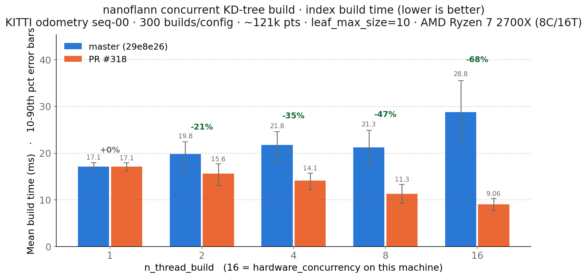
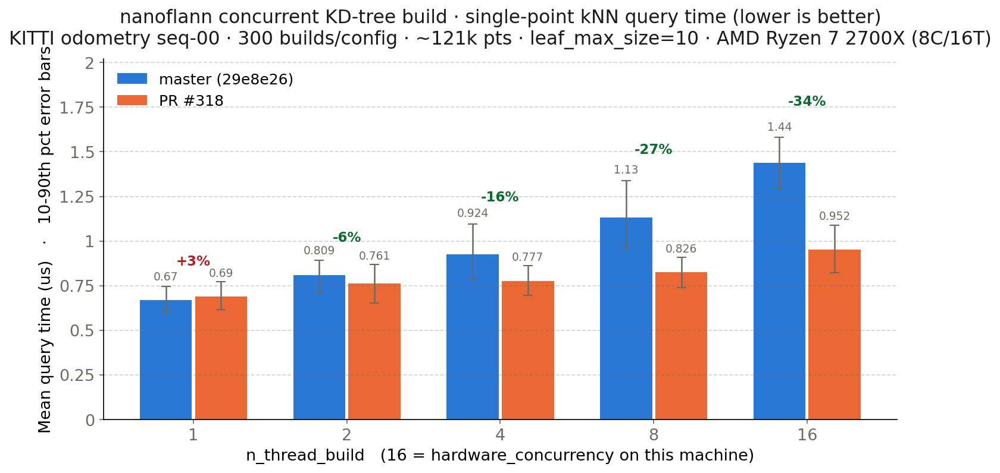
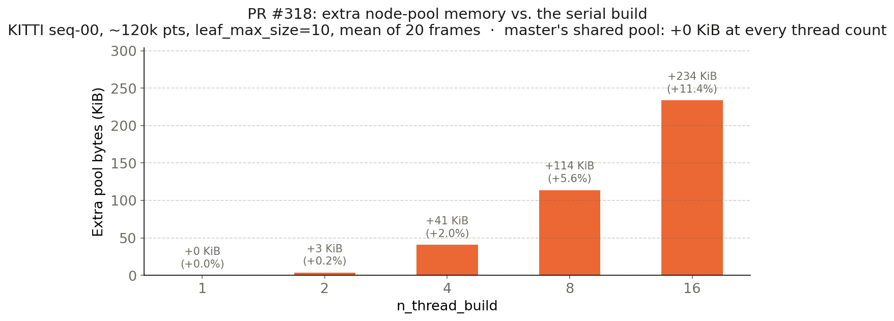

# concurrentBuildTests

Independent evaluation of nanoflann's **concurrent KD-tree build**
(`n_thread_build > 1`, i.e. `KDTreeBaseClass::divideTreeConcurrent`).

Two things get measured, against two nanoflann working copies side by side:

* **correctness** — does the concurrent build produce exactly the tree the serial
  build produces, is it race-free, leak-free and exception-safe;
* **speed and footprint** — build time, query time on the resulting tree, and
  node-pool memory, on real KITTI LiDAR clouds.

The results committed here compare `jlblancoc/nanoflann` `master` (29e8e26) with
[PR #318](https://github.com/jlblancoc/nanoflann/pull/318), which replaces the
mutex-guarded shared node pool with one private pool per spawned task.

## Layout

| Path | What it is |
|---|---|
| `verify_mt_build.cpp` | Serial-vs-concurrent equality for the static index: fingerprints the `vAcc_` permutation, the root bbox and a pre-order walk of every node, then compares 10-NN answers. Also prints the pool footprint per thread count (`MEM` lines). |
| `verify_dyn_mt_build.cpp` | The same for `KDTreeSingleIndexDynamicAdaptor`, including under `removePoint` churn. |
| `exc_safety.cpp` | A dataset adaptor that throws from `kdtree_get_pt` once a worker task is demonstrably running. Run under ASAN: catches a pool being freed while a spawned task still allocates from it. |
| `peak_threads.cpp` | Checks the advertised bound "at most `n_thread_build_` threads at once". Needs the instrumented header from `gen_variants.py`. |
| `kitti_sweep.cpp` | Build-time sweep over `n_thread_build` with the clouds pre-loaded, so disk I/O never enters the timing. Optionally reports tasks spawned per build. |
| `kitti_pool_mem.cpp` | `usedMemory + wastedMemory` of the node pool per thread count, on real clouds. |
| `gen_variants.py` | Derives instrumented / retuned copies of a nanoflann header (spawn counter, peak-concurrency tracker, and overrides of the task-size cutoff). |
| `run_checks.sh` | Drives every correctness harness, including ASAN/UBSAN/TSAN. |
| `run_kitti.sh` | Drives the KITTI benchmark and regenerates the figures and the table. |
| `results/`, `figures/` | Committed raw numbers and plots. |

`kitti_bench_{baseline,candidate}` is `benchmarkTool/realTests/benchmark_nanoflann_real.cpp`
compiled verbatim once per header, so its numbers stay comparable with that tool's.
Compile flags match it too: `-O3 -DNDEBUG`, deliberately **no** `-march=native`.

## Running it

```bash
export KITTI_BASE_DIR=$HOME/datasets/kitti/   # KITTI odometry root
export KITTI_SEQ=00

./run_checks.sh /path/to/baseline/include /path/to/candidate/include
./run_kitti.sh  /path/to/baseline/include /path/to/candidate/include 100 3
```

Both scripts configure and build `build/` themselves. `run_kitti.sh` interleaves
the two headers per (repetition, thread-count) so CPU frequency drift affects
both equally, then rewrites `results/table.md` and the figures.

## Findings (master 29e8e26 vs PR #318)

AMD Ryzen 7 2700X (8C/16T), KITTI odometry seq-00, ~121k pts/cloud,
`leaf_max_size=10`, `double`, `DIM=3`, 300 builds per configuration.



| threads | master build | PR #318 build | PR vs master | PR vs own serial | master query | PR query |
|---:|---:|---:|---:|---:|---:|---:|
| 1 | 17.11 ms | 17.15 ms | 1.00x | 1.00x | 0.670 µs | 0.690 µs |
| 2 | 19.83 ms | 15.64 ms | **1.27x** | 1.10x | 0.809 µs | 0.761 µs |
| 4 | 21.76 ms | 14.14 ms | **1.54x** | 1.21x | 0.924 µs | 0.777 µs |
| 8 | 21.25 ms | 11.27 ms | **1.89x** | 1.52x | 1.134 µs | 0.826 µs |
| 16 | 28.77 ms | 9.06 ms | **3.17x** | 1.89x | 1.437 µs | 0.952 µs |

* On `master` the concurrent build is **slower than its own serial build at every
  thread count** — 1.68x slower at 16 threads. The per-node mutex more than eats
  the parallelism. The PR turns that into a real 1.89x speedup.
* **Query time on the resulting tree also improves.** The tree is bit-identical
  either way, but `master`'s shared pool interleaves nodes from different threads
  and wrecks traversal locality: an MT-built tree queries **2.15x slower** than a
  serial-built one (0.67 → 1.44 µs). Per-task pools keep each subtree contiguous
  and cut that penalty to +38%.

  

* **Memory** is the one regression: each task's pool wastes the tail of its last
  block. +234 KiB (+11.4%) at 16 threads on these clouds. Worst synthetic case
  (200k pts, `leaf_max_size=64`, 32 threads) is +166% — a small tree with many
  tasks — but only +651 KiB in absolute terms. `master` wastes nothing, since all
  threads share one pool.

  

* The **task-size cutoff** the PR hard-codes (512 points) is a reasonable default:
  sweeping it over {512, 2048, 8192, 32768} puts 512 and 2048 together at the top
  and the larger values clearly behind. About 51 `std::async` tasks are spawned
  per build at 16 threads (~121k pts), each a fresh OS thread; a persistent pool
  would be the next thing to try.

* The **concurrency bound holds exactly**: peak in-flight tasks equals
  `n_thread_build - 1` for every thread count tried, and never goes negative.

* Correctness, both headers: trees bit-identical to the serial build across 19
  cases (N = 1…200k, `leaf_max_size` 1/10/64, uniform / all-duplicates /
  collinear / 99:1-skewed clouds), identical 10-NN answers, clean under TSAN and
  under ASAN+UBSAN+LeakSanitizer.

* **One defect found in the PR** (reported upstream): in `divideTreeConcurrent`
  the private pool is declared *after* the `std::future`, so during unwinding the
  pool is freed before the future joins the task. If user code throws mid-build,
  a still-running task keeps allocating from freed memory — reproducible 3/3 under
  ASAN with `exc_safety.cpp`. `master` is clean on the same test. Swapping the two
  declarations fixes it.
