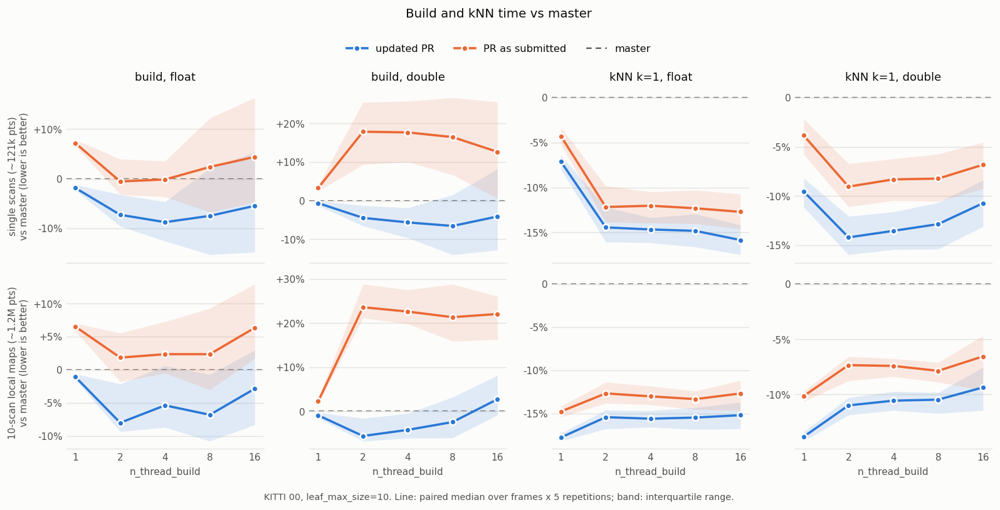
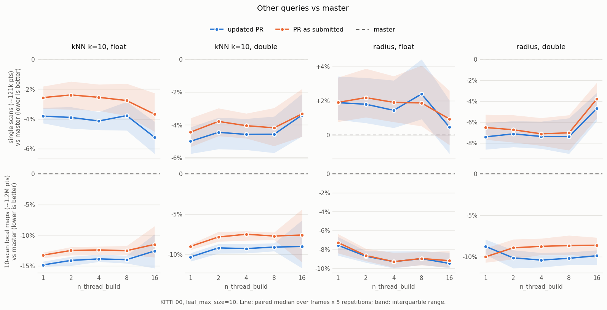

# vectorNodesTests

Independent evaluation of [PR #319](https://github.com/jlblancoc/nanoflann/pull/319),
which stores the static KD-tree nodes in **one contiguous `std::vector<Node>` in
pre-order** (children addressed by relative offsets) instead of pointer-linked
nodes carved from a `PooledAllocator`, and of the changes made on top of it.

Compared headers:

| name | what |
|---|---|
| `baseline` | `jlblancoc/nanoflann` `master` (a9051da, v1.13.0) |
| `prorig` | PR #319 as submitted (9974869) |
| `final` | PR #319 updated (2f47f07): 808bf55 + revert of 9974869 + the 4 commits below |
| `v2` | 558db66: vector nodes, gather reverted, memory fixes, load validation |
| `v2g` / `v2l` / `v2p` | `v2` plus one candidate change each (`variants/`): gather split coordinates again (scratch freed after the build), splice only task-built subtrees, prefetch the right child |

`final` = `v2` + `v2l` + `v2p`. The headers of commits are taken with
`git show <sha>:include/nanoflann.hpp`.

## Layout

| Path | What it is |
|---|---|
| `fingerprint.cpp` | Storage-agnostic fingerprint (pointer or array nodes) of the tree (pre-order walk), `vAcc_`, and of kNN / radius / box answers; kNN also checked against brute force. 7 element/metric/DIM/IndexType combos, 6 point distributions, N = 0...150k, leaf 1/10/64, `n_thread_build` 1,2,3,4,8,16,0; save/load round trip; in-place rebuilds over a growing/shrinking dataset; dynamic index with chunked adds and removals. Env: `FP_MAXN`, `FP_NOSAVE`, `FP_ONLY_DYNAMIC`. |
| `exc_safety.cpp` | Adaptor throwing mid concurrent build, from the calling thread or a worker task; then checks the index reports "not built" and rebuilds fine. |
| `kitti_vn.cpp` | KITTI benchmark: fresh build, in-place rebuild, kNN k=1/10, radius, `usedMemory()`, heap kept; dynamic-index map grown scan by scan. `KITTI_ACCUM=10` merges 10 consecutive scans with the ground-truth poses into the frame of the latest one (a LiDAR-odometry local map, ~1.24M points) and takes queries from the next scan. `KITTI_RADIUS` sets the radius. |
| `build_probe.cpp` | Tight build-only loop; with `variants/pr319_probe` it reports splice memmove volume and time blocked in `future::get()`. |
| `run_kitti2.sh`, `run_kitti2_dyn.sh` | Interleaved runs over several binaries. A run only starts once no other process is busy, and a run during which one shows up is discarded and repeated (`clean_runs.log`). |
| `wait_then_final.sh`, `run_all_v2.sh` | Drivers of the `final*` and `results*` runs. |
| `analyze.py`, `ablation.py`, `plot_final.py` | Tables (`*/table.md`), the per-change ablation table, and `figures/`. |

```bash
source ~/ros2_ws/install/setup.bash
export KITTI_BASE_DIR=$HOME/datasets/kitti/ KITTI_SEQ=00
cmake -S . -B build-cmake -DNANOFLANN_BASELINE_INCLUDE_DIR=<master>/include \
      "-DKITTI_EXTRA_HEADERS=final=<dir>;prorig=<dir>"
cmake --build build-cmake -j
./run_kitti2.sh final10x 10 20 5 0.5 baseline prorig final
./analyze.py final10x && ./plot_final.py
```

## Findings

AMD Ryzen 7 2700X (8C/16T), KITTI odometry seq 00, `leaf_max_size=10`,
`DIM=3`, `-O3 -DNDEBUG`, idle machine. Single scans: 150 scans (~121k
points), 5 repetitions. Maps: 20 local maps of 10 scans (~1.24M points), 5
repetitions. Paired medians vs `baseline`; running identical code twice
(`results*/static_v2replicate.csv`) shows a noise level of about +-2-3%.




`final` vs `master` (`final1x/`, `final10x/`), over `n_thread_build` 1..16:

| | single scans | 10-scan maps |
|---|---|---|
| build, float | -2..-9% | -1..-8% |
| build, double | -1..-7% | -6..+3% |
| kNN k=1 | -7..-16% | -9..-18% |
| kNN k=10 | -3..-5% | -9..-15% |
| radius, float / double | +0.5..+2.5% / -5..-7% | -7.5..-9.5% / -9..-10% |
| memory, float / double | -33..-40% / -22..-29% | -30..-35% / -18..-22% |

`prorig` (the PR as submitted) builds `double` indices 13-24% slower than
`master` with several threads, and its indices are larger than on `master`
with `double` (+5..+21%).

Each change on its own, paired median vs `v2` (`results1x/`, `results10x/`, 3
repetitions):

| change | size | build f32 T=1 | build f32 T>1 | build f64 T=1 | build f64 T>1 | kNN1 f32 | kNN1 f64 |
|---|---|---:|---:|---:|---:|---:|---:|
| gather split coordinates (original last commit) | 1x | +9.2% | +7.1% | +2.8% | +16.1% | +0.1% | +2.3% |
| gather split coordinates (original last commit) | 10x | +7.7% | +6.4% | +3.2% | +21.3% | +0.3% | -0.7% |
| splice only task-built subtrees | 1x | +0.6% | -2.3% | -0.8% | -3.9% | -0.7% | -0.6% |
| splice only task-built subtrees | 10x | -0.2% | -2.4% | -0.2% | -3.7% | -0.7% | +0.3% |
| prefetch right child | 1x | +0.1% | -0.0% | -1.4% | -1.3% | -2.0% | -3.2% |
| prefetch right child | 10x | -0.5% | -0.4% | -1.1% | -0.9% | -2.8% | -3.5% |

Dynamic index, map grown scan by scan (every 4th point, 4.56M points at the
end, `finaldyn/`, median of 3 runs):

| T | metric | master | PR as submitted | updated PR |
|---|---|---:|---:|---:|
| 1 | addPoints total [s] | 2.75 | 2.79 (+1%) | 2.78 (+1%) |
| 1 | kNN k=1 [us/q] | 4.95 | 4.47 (-10%) | 4.37 (-12%) |
| 1 | heap kept [MiB] | 106 | 147 (+38%) | 92 (-14%) |
| 4 | addPoints total [s] | 1.70 | 1.70 (+0%) | 1.63 (-4%) |
| 4 | kNN k=1 [us/q] | 5.02 | 4.60 (-8%) | 4.52 (-10%) |
| 4 | heap kept [MiB] | 107 | 147 (+38%) | 92 (-14%) |

The +38% came from `freeIndex()` having become `clear()`: sub-trees merged
into a larger one kept their node arrays.

Without a spawned task, the concurrent builder of `prorig` moved about 5x the
whole node array per build (3.4 MB float, 6.9 MB double on a KITTI scan;
`build_probe` with `variants/pr319_probe`), which the "splice only task-built
subtrees" change removes.

**Correctness.** `final` and `prorig` give the same trees, `vAcc_` and
kNN/radius/box answers as `master` in all ~7,500 fingerprint cases (static and
dynamic, every thread count), and kNN distances agree with brute force. Clean
under ASAN+UBSAN and TSAN (fingerprint up to N=20k, and real KITTI clouds with
up to 16 build threads) and MSan (serial builds: libstdc++'s `std::future` is
not instrumented). The nanoflann unit tests pass under ASAN+UBSAN and TSAN. An
exception thrown mid-build, on the calling thread or in a worker, unwinds
cleanly.

**Side finding, also on `master`:** `KDTreeSingleIndexDynamicAdaptor` does not
check `maximumPointCount`. Adding more points than that indexes `index_` out of
bounds, and `maximumPointCount = 0` casts `log2(0)` to `size_t`.
